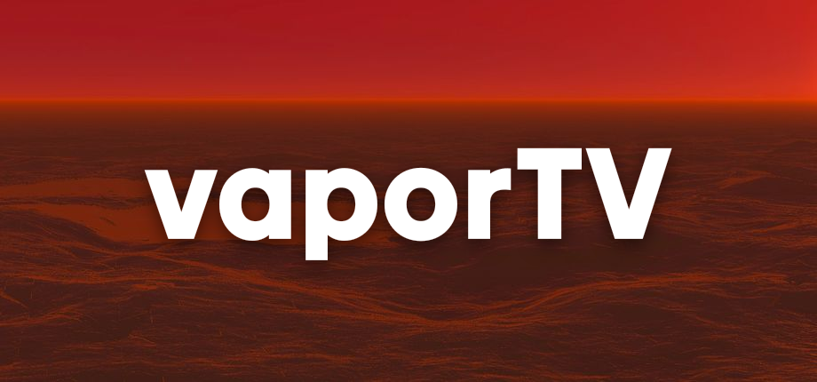
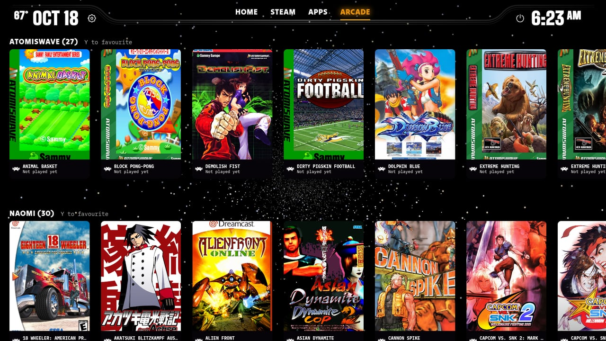
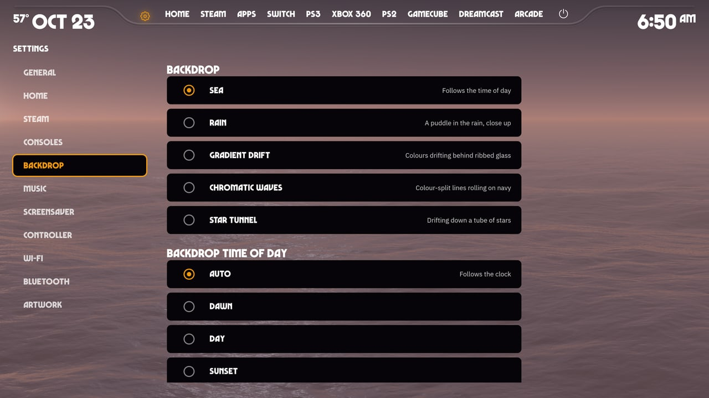
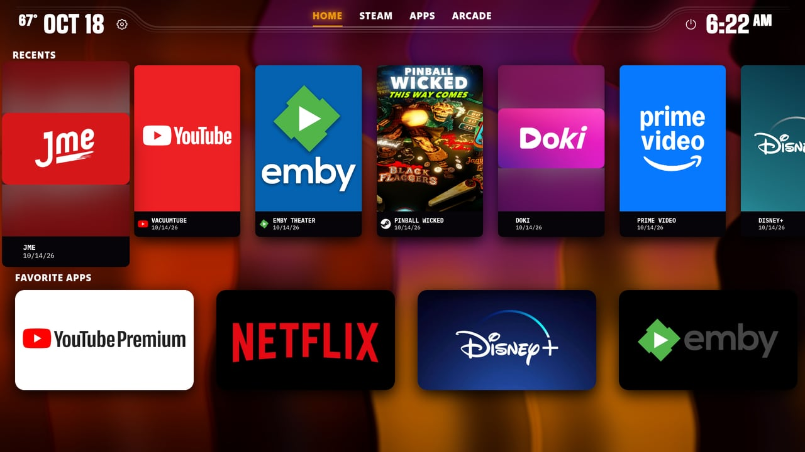
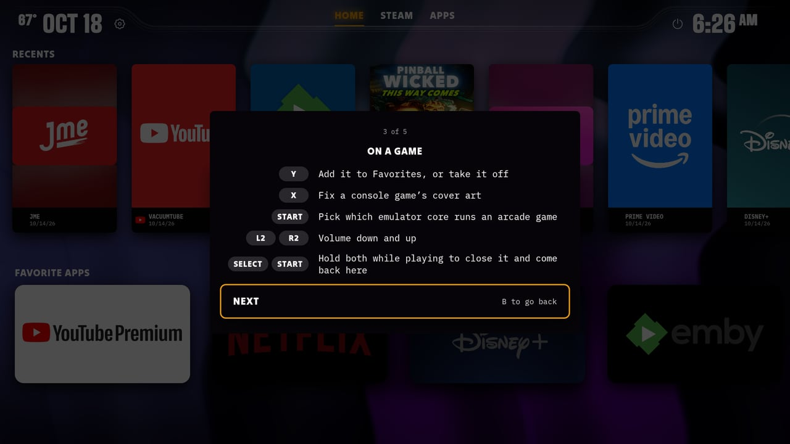
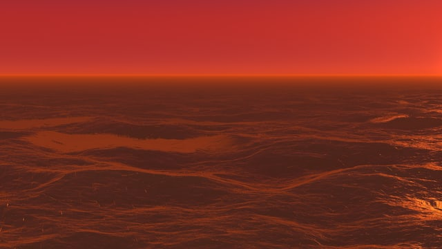
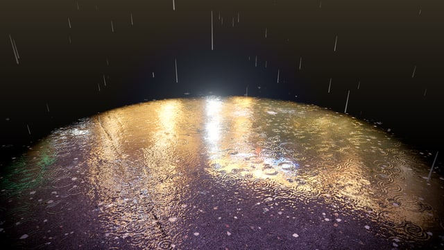
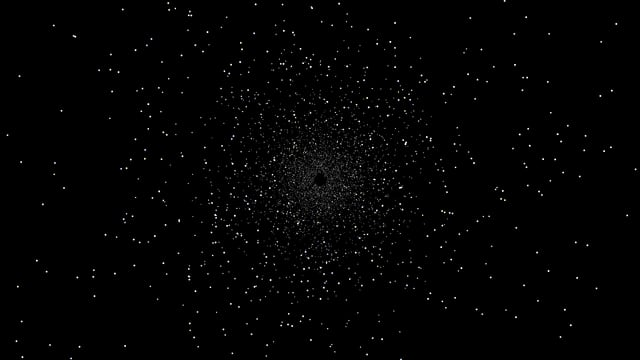

<p align="center">
  
</p>

<p align="center">
  <b>An Android TV–style home screen for SteamOS.</b><br>
  Your Steam library, emulated consoles and streaming apps in one place, run entirely from the couch with a controller.
</p>

<p align="center">
  <a href="https://github.com/hplant6/vaportv/releases/latest"><b>Download</b></a> ·
  <a href="#install">Install</a> ·
  <a href="#features">Features</a> ·
  <a href="#controller">Controller</a>
</p>

.

## A look around

| | |
|---|---|
|  |  |
| **Arcade:** Atomiswave, NAOMI, CPS, Neo Geo and MAME sets, named and with cover art | **Settings:** everything from the controller, in two columns |
|  |  |
| **Home**, here over the Gradient Drift backdrop | **A welcome tour** on the first start, showing the buttons |

### Backdrops

|  |  |  |  |  |
|:--:|:--:|:--:|:--:|:--:|
| **Sea**, following the time of day | **Rain** on a puddle | **Gradient Drift**, seven palettes | **Chromatic Waves** | **Star Tunnel**, four colourings |

## Install

1. In **Desktop Mode**, download `vaporTV.AppImage` from the [latest release](https://github.com/hplant6/vaportv/releases/latest).
2. Open it from Dolphin (your Downloads folder). If Plasma asks whether to run it, allow it; if nothing happens, right-click it → **Properties** → **Permissions** → tick **Is executable**, then open it again.
3. The **vaporTV setup** window opens. Choose:
   - **Open vaporTV when Gaming Mode starts** (recommended)
   - **Let my controller wake the box from sleep**: needs an admin password. SteamOS has none until you set one with `passwd` in Konsole; without it this step is skipped.
   - **Apps** to set up: streaming services open in Google Chrome (installed from Flathub if needed) as Steam shortcuts; YouTube, Emby, Jellyfin, Plex and Kodi install their own apps from Flathub.
4. Click **Install**. Steam closes for a moment while vaporTV is added to your library.
5. Click **Return to Gaming Mode**. A short welcome tour shows the buttons.

To update, download the new AppImage and run setup again. To remove vaporTV, open the AppImage in Desktop Mode and click **Uninstall**. Apps can also be set up later from the **Apps** tab: anything not set up yet is dimmed with a **Set up** label.

## Guides

Step-by-step help for streaming apps, emulators, the Netflix extension, TV remotes and SteamOS updates is in [docs/guides](docs/guides/README.md). The same guides are built into vaporTV under **Settings → Help**.

## Features

**Home and tabs**
- **Home:** Recents (Steam games, emulated games and apps, by when you last played) and Favorite Apps, as carousels or grids
- **Steam:** your Steam collections, including dynamic ones, and recently played
- **Consoles:** Switch, PS3, Xbox, Xbox 360, PS2, PSX, PSP, GameCube, Wii, Wii U, Dreamcast, Saturn, N64, NES, SNES, Genesis, 32X and Amiga, from EmuDeck's folders; a tab only shows when its emulator and games are there (see the [emulators guide](docs/guides/emulators.md))
- **Arcade:** Atomiswave, NAOMI, NAOMI 2, CPS, Neo Geo and MAME sets, named from MAME's list, each in RetroArch with the right core (and a choice of core per game)
- **Apps:** streaming services and media apps, with setup for anything missing

**Art**
- Covers from [SteamGridDB](https://www.steamgriddb.com/) (with a free API key) and the libretro thumbnails
- Pick any game's art by hand: SteamGridDB, RetroArch's box art, or a web image search

**Around the room**
- **Select + Start** (held) closes whatever is running and comes back to vaporTV
- Volume on the triggers, and every button can be reassigned
- Switching the controller off puts the box to sleep; switching it on wakes it
- Five live backdrops, background music, and a screensaver (your game art, Steam screenshots, your photos, or a big clock)
- Weather for your area, a power menu, and a welcome tour

## Controller

| Button | Does |
|---|---|
| D-pad / left stick | Move |
| A | Open what's highlighted |
| B | Back |
| L1 / R1 | Previous / next tab |
| Y | Add to Favorites, or take off |
| X | Fix a console game's cover art |
| Start | Game options: rename, emulator, art or delete (on an app: its details) |
| Select | Show what each button does, along the bottom |
| R3 | Voice search |
| L2 / R2 | Volume down / up |
| Select + Start (hold) | Close the game or app and return to vaporTV |

All but the D-pad and Select + Start can be moved to other buttons in **Settings → Controller**.

## Requirements

SteamOS 3.7 or later in Gaming Mode, on a TV. A Steam Deck works docked to a TV. Handheld play is **experimental**: vaporTV runs and shows the battery, but its layout is made for a TV (with thin bars on the Deck's taller screen) and the live backdrops aren't tuned for battery life yet. Emulated games need [EmuDeck](https://www.emudeck.com/).

## Building

```sh
npm install
npm run dev          # run it on a desktop for development
npm run typecheck && npm test
npm run dist         # build the AppImage (dist/vaporTV.AppImage)
```

`npm run dist` builds with the author's extras (a Google Photos add-on and an unofficial DuckDuckGo image search); `VAPORTV_PUBLIC=1 npm run dist` builds the public release without them. `scripts/release.sh` builds that and publishes it as a GitHub release.

## Licence

vaporTV is free software under the [GNU General Public License v3.0 or later](LICENSE). Third-party fonts, sounds, artwork and code it includes, and their licences, are listed in [NOTICE.md](NOTICE.md).

vaporTV ships no service logos: app tiles are downloaded from SteamGridDB on your box (add a free SteamGridDB key in Settings → Artwork), and show the app's name until then. Service names belong to their owners; vaporTV is not affiliated with them. Privacy policy: https://itshenry.me/vaportv/privacy/
