<p align="center">
  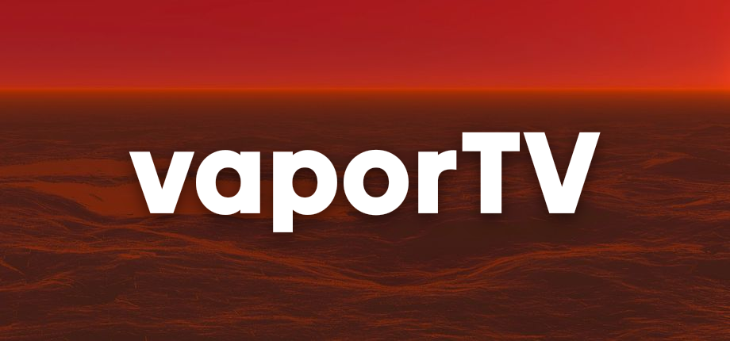
</p>

<p align="center">
  <b>An Android TV–style home screen for SteamOS.</b><br>
  Your Steam library, emulated consoles and streaming apps in one place, run entirely from the couch with a controller.
</p>

<p align="center">
  <a href="https://github.com/hplant6/vaportv/releases/latest"><b>Download</b></a> ·
  <a href="#before-you-start">Before you start</a> ·
  <a href="#install">Install</a> ·
  <a href="#features">Features</a> ·
  <a href="#controller">Controller</a>
</p>

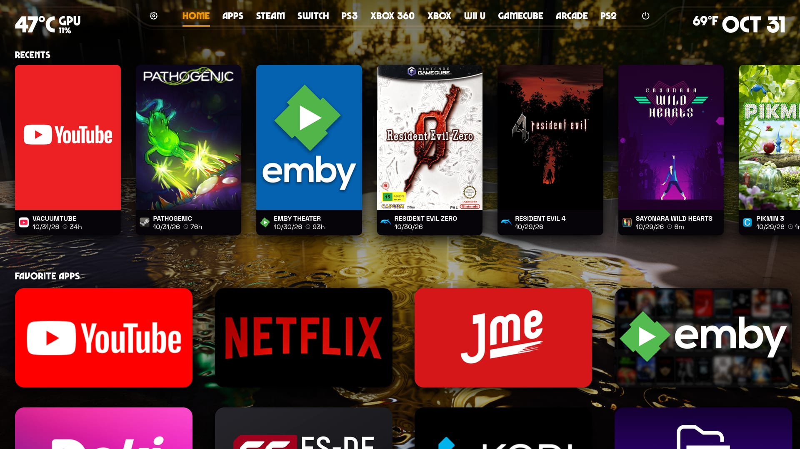

> **Status: early.** vaporTV runs daily on its author's living-room box. Expect rough edges, and please [report them](https://github.com/hplant6/vaportv/issues): **Settings → Help → Report a problem** fills in the details for you.

## Before you start

vaporTV is a front end: it shows and opens what's already on your box. Here's what each part needs.

| You want | You need |
|---|---|
| **vaporTV itself** | SteamOS 3.7 or later, in Gaming Mode, on a TV. A Steam Deck works docked to a TV; in your hands it's **experimental** (it runs and shows the battery, but it's laid out for a TV). Installing it takes one visit to **Desktop Mode**. |
| **Your Steam games** | Nothing more: vaporTV reads your Steam library and collections. |
| **Emulated console games** | **[EmuDeck](https://www.emudeck.com/)**, with its emulators installed and your games in its `Emulation/roms` folders. vaporTV doesn't emulate anything itself; a console's tab appears once its emulator and its games are there. The [emulators guide](docs/guides/emulators.md) lists every console's folder, emulator and file types. |
| **Cover art and app tiles** | A free **[SteamGridDB](https://www.steamgriddb.com/) API key** (sign in there, then Preferences → API), added in **Settings → Artwork**. Console games also get box art from RetroArch's thumbnails without one. Until art arrives, a card shows its name. |
| **Streaming apps** | Internet, and the setup's app picks: Netflix, Disney+ and the other services open in Google Chrome (setup installs it from Flathub); YouTube, Emby, Jellyfin, Plex and Kodi install their own apps. See the [streaming apps guide](docs/guides/streaming-apps.md). |
| **Controller or remote wake; Netflix with a controller or remote** (optional) | An admin password, which SteamOS doesn't have until you set one: open Konsole in Desktop Mode and run `passwd`. Without it, setup skips just these steps. |
| **Voice search** (optional) | A microphone (a remote's, or a headset's). The speech model (about 150 MB) downloads the first time you use it; after that, speech is understood on the box, with nothing sent anywhere. |

A controller is all you need to use it; a TV remote (such as a Sofabaton) or a keyboard works too. The download is around 400 MB.

## Install

1. In **Desktop Mode**, download `vaporTV.AppImage` from the [latest release](https://github.com/hplant6/vaportv/releases/latest).
2. Open it from Dolphin (your Downloads folder). If Plasma asks whether to run it, allow it; if nothing happens, right-click it → **Properties** → **Permissions** → tick **Is executable**, then open it again.
3. The **vaporTV setup** window opens. Choose:
   - **Open vaporTV when Gaming Mode starts** (recommended)
   - **Let my controller wake the box from sleep**: needs the admin password (see above).
   - **Apps** to set up: streaming services, media apps and Kodi.
4. Click **Install**. Steam closes for a moment while vaporTV is added to your library.
5. Click **Return to Gaming Mode**. A short welcome tour shows the buttons.

After that, vaporTV updates itself: it checks for new versions, shows what changed, and installs them from the couch (**Settings → General → Updates**). Updates are signed, so it installs only ones that came from vaporTV. To remove vaporTV, open the AppImage in Desktop Mode and click **Uninstall**. Apps can also be set up later from the **Apps** tab: anything not set up yet is dimmed with a **Set up** label.

## A look around

| | |
|---|---|
| 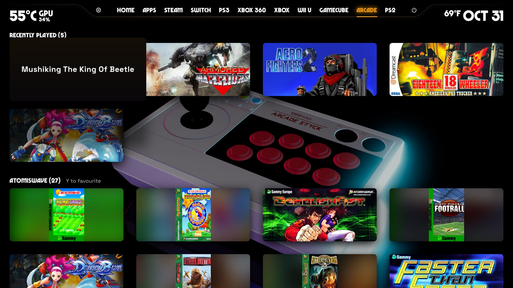 | 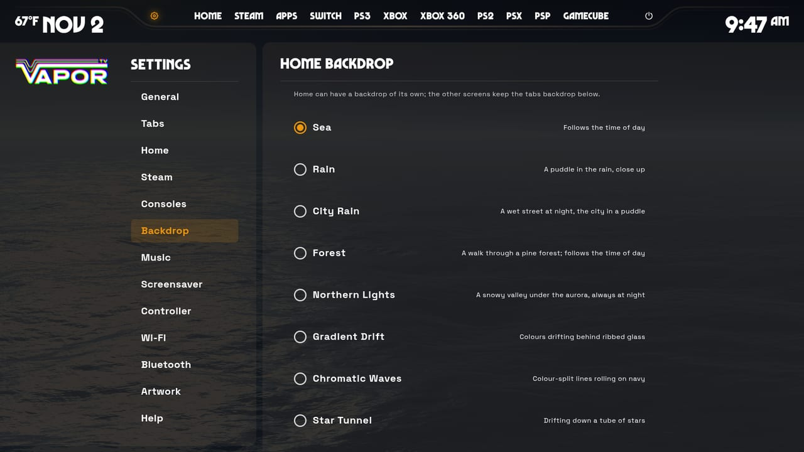 |
| **Arcade:** Atomiswave, NAOMI, CPS and MAME sets, named and with cover art | **Settings:** everything from the controller, in two columns |
| 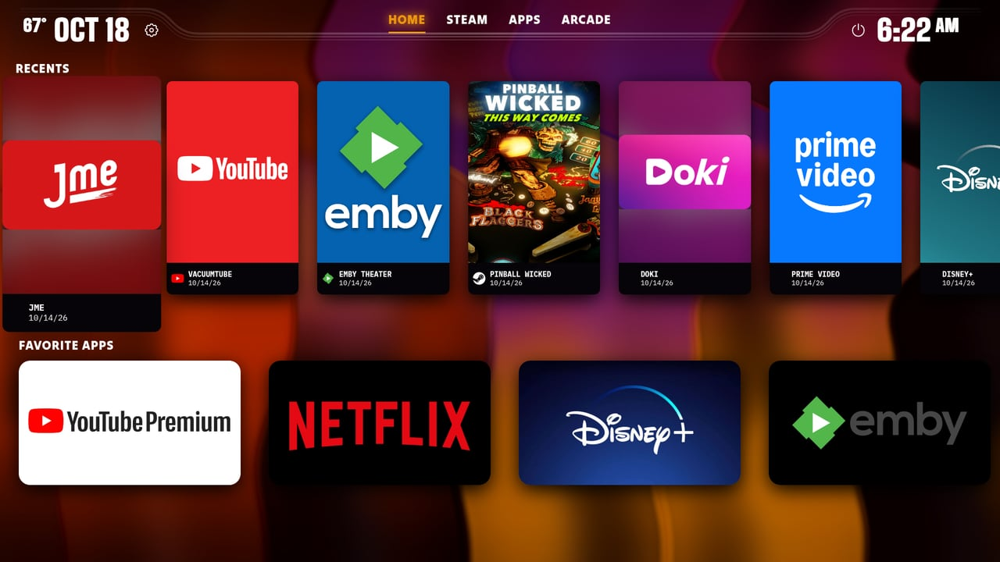 | 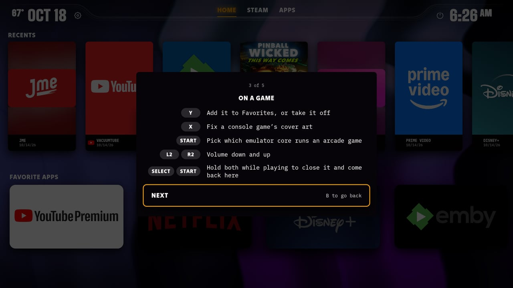 |
| **Home**, here over the Gradient Drift backdrop | **A welcome tour** on the first start, showing the buttons |
| 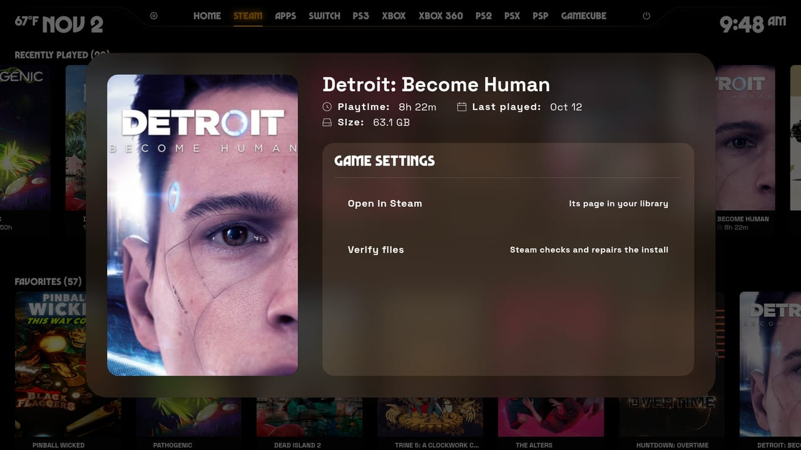 | 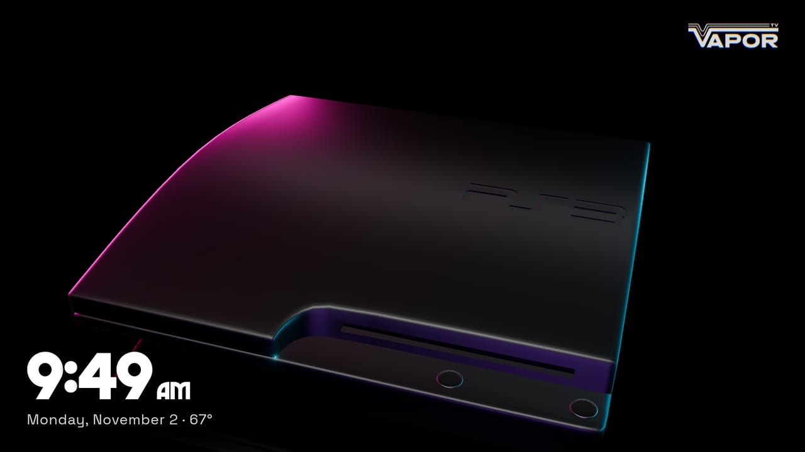 |
| **Game options** (Start on any game): its cover, playtime and size. Steam games open in Steam or verify their files; console games can be renamed, moved to another emulator, given new art, or deleted | **The Consoles screensaver:** each of your consoles in turn, with the clock where you want it |

### Consoles in 3D

Each console's tab shows that console turning slowly at the top of its list on the left (the Steam tab a Steam Deck, Arcade a Taito Egret 29 cabinet). The Consoles screensaver shows them full screen on a mirror floor, as below, and the Apps tab its pile of VHS tapes.

| 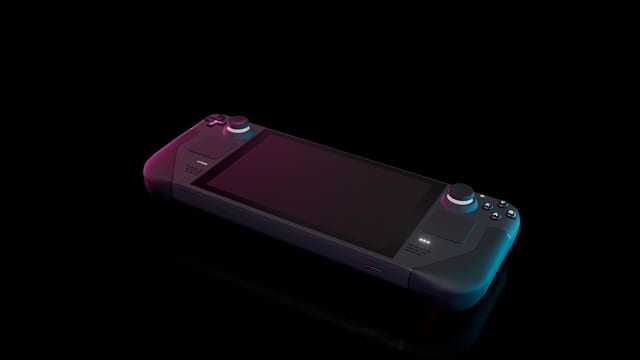 | 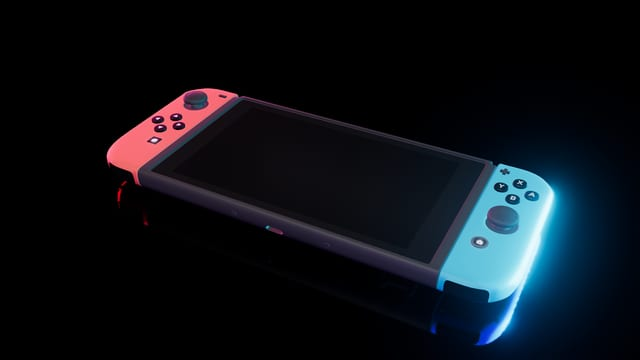 | 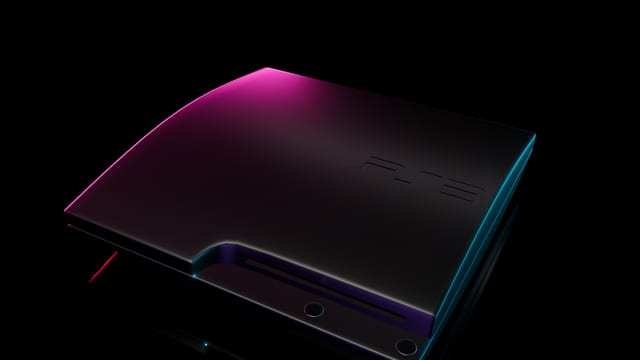 | 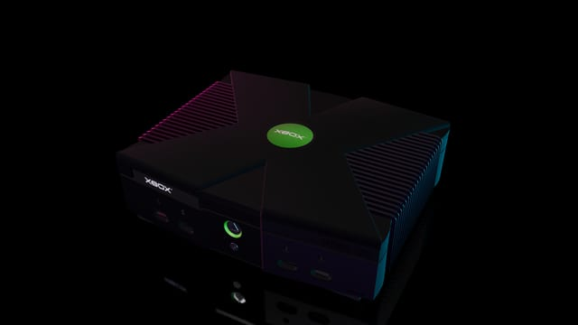 | 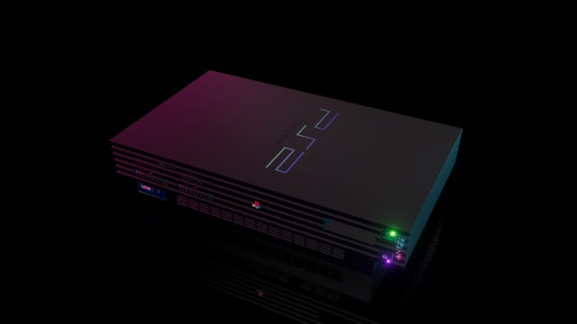 |
|:--:|:--:|:--:|:--:|:--:|
| **Steam** | **Switch** | **PS3** | **Xbox** | **PS2** |
| 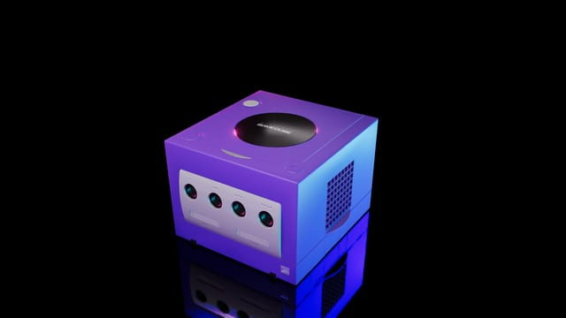 | 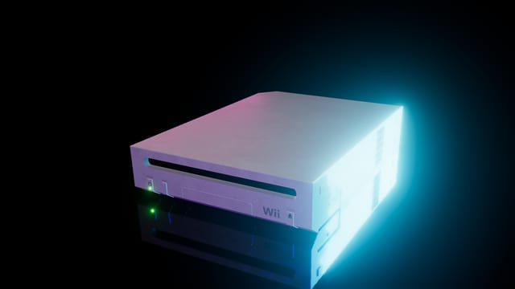 | 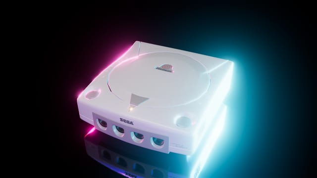 | 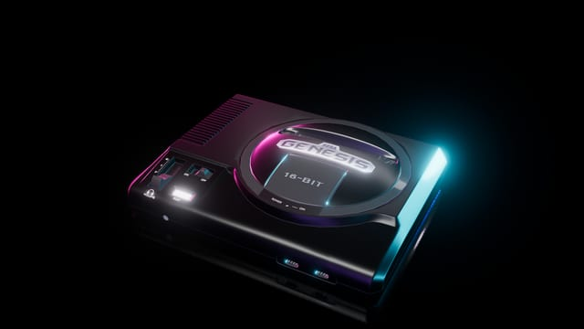 | 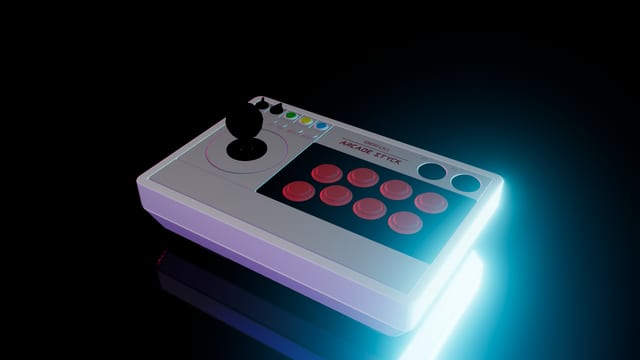 |
| **GameCube** | **Wii** | **Dreamcast** | **Genesis** | **Arcade** |
| 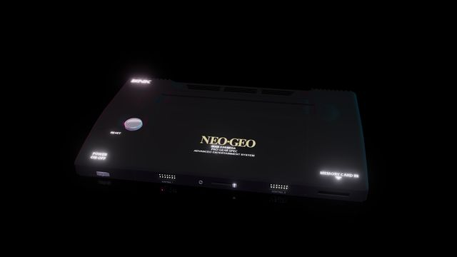 | | | | |
| **Neo Geo** | | | | |

PSX, PSP, Xbox 360, Wii U, N64, NES, SNES, Saturn and 32X have theirs too, and the Apps tab a pile of VHS tapes. The **Consoles** screensaver shows each of yours in turn.

### Backdrops

|  | 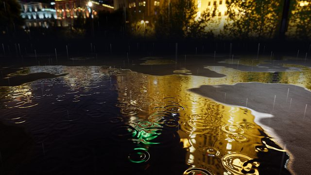 |  |  | 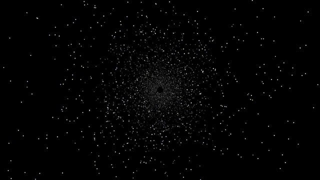 |
|:--:|:--:|:--:|:--:|:--:|
| **Sea**, following the time of day | **City Rain**, a wet street at night | **Gradient Drift**, seven palettes | **Chromatic Waves** | **Star Tunnel**, four colourings |

## Features

**Home and tabs**
- **Home:** Recents (Steam games, emulated games and apps, by when you last played) and Favorite Apps, as carousels or grids
- **Steam:** your Steam collections, including dynamic ones, and recently played
- **Consoles:** Switch, PS3, Xbox, Xbox 360, PS2, PSX, PSP, GameCube, Wii, Wii U, Dreamcast, Saturn, N64, NES, SNES, Genesis, 32X and Neo Geo, each opening its games in the right emulator; a tab only shows when its emulator and games are there. Cards show the icon of the emulator a game opens in
- **Arcade:** Atomiswave, NAOMI, NAOMI 2, CPS1, CPS2, CPS3 and MAME sets, named from MAME's list (and Capcom's sorted by board from it), each in RetroArch with the right core (and a choice of core per game)
- **Apps:** streaming services and media apps, with setup for anything missing, and **Files**, for browsing your folders, USB drives and SD cards, and copying games onto the box. **Netflix** works with a controller or a TV remote through vaporTV's own extension, with its pop-ups and scrollbars out of the way
- **The top bar:** up to eleven tabs, with the rest in a second row that opens when you press down from it; **Settings → Tabs** puts each tab where you want it, or switches it off

**Games**
- **Game options** (Start on any game or app): its cover, how long and when you last played, its size; rename it, choose its emulator, replace its art, or delete it from the drive
- Steam games show their playtime, achievements and size from Steam's own records, with **Open in Steam** and **Verify files**
- Time played on every card: Steam's count for Steam games, vaporTV's for the console games it starts
- **Search** across every tab and app, typed or spoken: **voice search** understands "Metroid Prime" or "play Halo 2" (which starts it straight away)

**Art**
- Covers from [SteamGridDB](https://www.steamgriddb.com/) (with a free API key) and the libretro thumbnails
- Pick any game's art by hand: SteamGridDB, RetroArch's box art, or a web image search (with a free [Brave Search API](https://brave.com/search/api/) key, added in **Settings → Artwork**)

**Backdrops**
- **Consoles in 3D:** each console's tab (Steam's a Steam Deck, Arcade's a Taito Egret 29 cabinet) shows that console turning slowly in its list on the left, lit in neon (**Settings → Backdrop → Spinning consoles** turns them off on a slower machine). Apps shows a pile of VHS tapes full screen, black on a mirror floor, the camera slowly swinging round it like a product shot, as the Consoles screensaver does every console. **Settings → Backdrop → Console backdrops** trades their sharpness for less work on the GPU
- **Seven live backdrops**: Sea and Forest (both following the time of day), City Rain, Northern Lights, Gradient Drift, Chromatic Waves and Star Tunnel; or **your own videos and pictures**, looped or shuffled
- **Home backdrop and Tabs backdrop**, chosen apart: the tabs show their consoles, or any backdrop instead, on every tab

**Sound and screensaver**
- Background **music** with **ambience** under it (rain, crickets, ocean waves, birdsong), each with its own volume. Two playlists come with it, **Ambient** (Chris Zabriskie) and **Retro** (chiptunes from OpenGameArt), all volume-matched; make your own, preview any song, and add music from a USB drive. Your songs are listed apart from the included ones, with their artist and length
- **Now playing** in Settings → Music, with back and next; **L3** skips to the next song from anywhere
- A **screensaver**: a slideshow of your game art, Steam screenshots and photos; the backdrop with a big clock; **your consoles**, one after another; or a clock with the weather. The clock moves around (kind to OLED TVs) or stays put in a corner or the middle

**Around the room**
- **Select + Start** (held) closes whatever is running and comes back to vaporTV
- Volume on the triggers, and every button can be reassigned
- Switching the controller off puts the box to sleep; switching it on wakes it. TV remotes work too: see the [remotes guide](docs/guides/remotes.md)
- Weather for your area, Wi-Fi and Bluetooth settings, a power menu, an intro video, and a welcome tour
- **Settings → Help:** the [guides](docs/guides/README.md), readable full screen or on your phone by QR code, and **Report a problem**, which opens a bug report on your phone with vaporTV's details filled in (and what's personal taken out)

## Controller

| Button | Does |
|---|---|
| D-pad / left stick | Move. Down from the top bar opens its second row |
| A | Open what's highlighted |
| B | Back |
| L1 / R1 | Previous / next tab |
| Y | Add to Favorites, or take off |
| X | Add a game to a playlist, or take it out |
| Start | Game options: rename, emulator, art or delete (on an app: its details) |
| L2 | Show or hide a tab's list of games (the left bar) |
| R2 | Show what each button does, along the bottom |
| Select | Settings |
| R3 | Voice search |
| L3 | Next song |
| L3 + R3 (both sticks in) | Sound off, or back on |
| Select + Start (hold) | Close the game or app and return to vaporTV |

All but the D-pad and Select + Start can be moved to other buttons in **Settings → Controller**.

## Guides

Step-by-step help for [streaming apps](docs/guides/streaming-apps.md), [emulators](docs/guides/emulators.md), the [Netflix extension](docs/guides/netflix-extension.md), [TV remotes](docs/guides/remotes.md), [what to do when an update breaks something](docs/guides/updates.md), and [privacy](docs/guides/privacy.md). The same guides are built into vaporTV under **Settings → Help**.

## Building

```sh
npm install
npm run dev          # run it on a desktop for development
npm run typecheck && npm test
npm run dist         # build the AppImage (dist/vaporTV.AppImage)
```

`npm run dist` builds with the author's extras (a Google Photos add-on and an unofficial DuckDuckGo image search); `VAPORTV_PUBLIC=1 npm run dist` builds the public release without them. `scripts/release.sh` builds that and publishes it as a GitHub release. The console models and the display font aren't in this repository; a build without them shows the usual backdrop on the console tabs and uses free fonts.

## Licence

vaporTV is free software under the [GNU General Public License v3.0 or later](LICENSE). Third-party fonts, sounds, artwork and code it includes, and their licences, are listed in [NOTICE.md](NOTICE.md).

vaporTV ships no service logos: app tiles are downloaded from SteamGridDB on your box, and show the app's name until then. Service, console and game names belong to their owners; vaporTV is not affiliated with them. Privacy policy: https://itshenry.me/vaportv/privacy/
